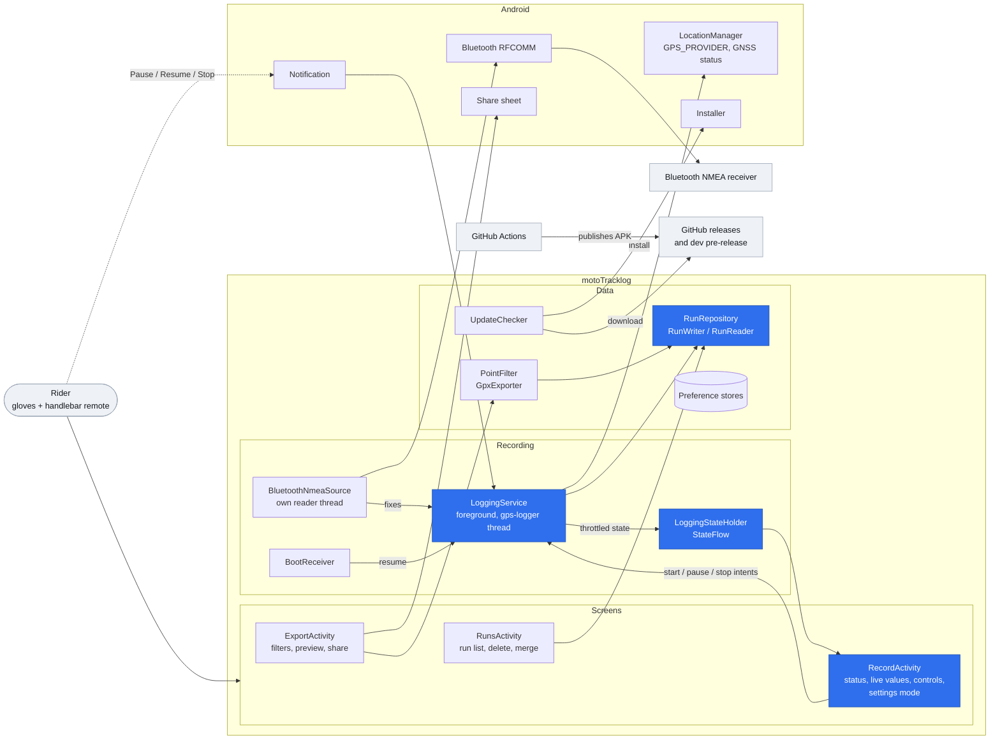
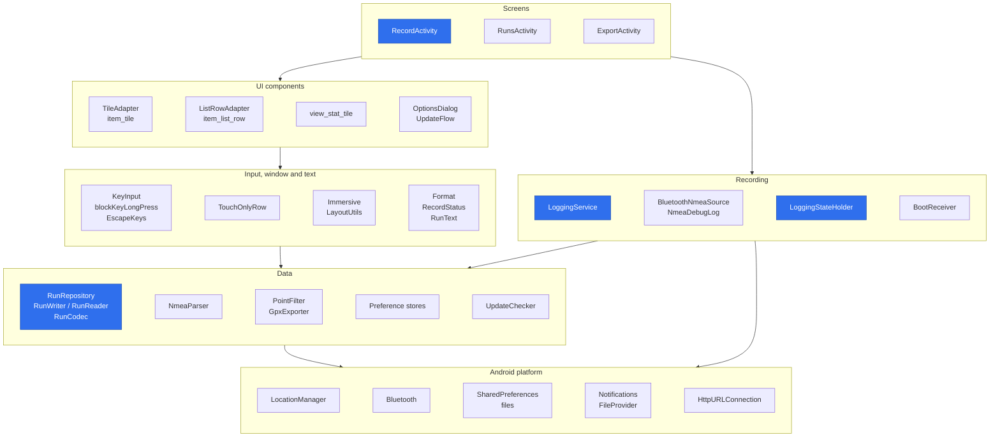
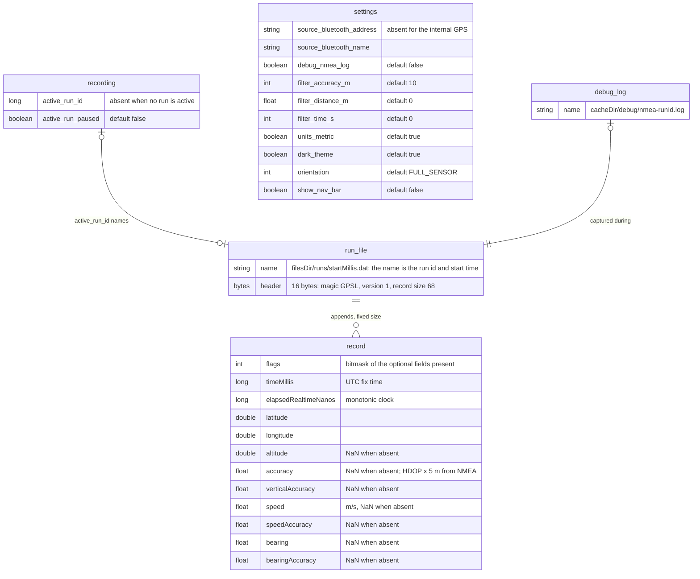

# Architecture

Blue nodes are primary components; the rest are secondary.

## High-level architecture

## Layers

## Persistent state

There is no database. A run is a binary file; settings and the active-run marker are
`SharedPreferences`, shown here as entities.

