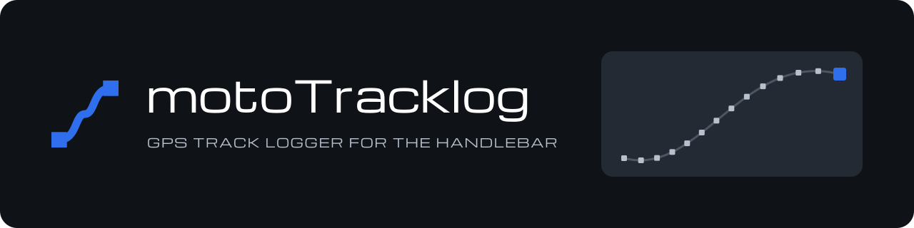

  

motoTracklog records the raw GPS track of a ride and exports it as GPX.
It runs on motorcycle navigation devices and is built for gloved hands and a handlebar remote.

## Features

- **Raw recording** — every fix at the receiver's native rate, in the background.
- **Internal GPS or Bluetooth receiver** — record from the device's chipset or a paired NMEA receiver.
- **Remote-safe** — the remote can start, pause and resume, but never stop a ride.
- **Cold pause** — a paused ride releases the receiver and draws no power.
- **Survives reboots** — an interrupted ride continues until you stop it.
- **GPX export** — filter by accuracy, distance or interval, then share.
- **Merge and delete** — join a ride with the one before it, or remove it.
- **Updates on request** — checks for a newer version only when you ask.

## Getting started

1. On Android 9 or newer, download the APK from the [latest release](https://github.com/c0dev0id/motoTracklog/releases/latest) and install it. Development builds are in the [dev pre-release](https://github.com/c0dev0id/motoTracklog/releases/tag/dev).
2. Open motoTracklog and allow precise location, notifications and location all the time.
3. Press **Start**.
4. After the ride, press **Stop**, tap the latest run and **Share GPX**.

To record from a Bluetooth receiver, pair it in Android first, then pick it in **Settings → GPS source**.

## Remote keys

| Key | Record screen | Runs, Export, Settings |
|---|---|---|
| Dpad | Move to the Start / Pause / Resume tile | — |
| Enter | Start, pause or resume | — |
| Escape | Leave settings, then close | Back |

Everything except Start, Pause and Resume is touch-only.

## Export filters

| Filter | Options |
|---|---|
| Accuracy | 5, 10 (default), 20, 50, 100 m |
| Min. distance | Off (default), 1, 2, 5, 10, 25, 50 m |
| Interval | Off (default), 1, 2, 5, 10, 30, 60 s; ignored while a distance is set |

## Settings

On the Record screen, **Settings**, by touch.

| Setting | Options |
|---|---|
| GPS source | Internal GPS (default), or a paired Bluetooth receiver |
| Units | km/h (default), mph |
| Debug NMEA log | Off (default), On |
| Share debug log | Shares the latest captured log |
| Theme | Dark (default), Light |
| Orientation | Sensor (default), Landscape, Portrait, Reverse landscape, Reverse portrait |
| Navigation bar | Hidden (default), Visible |
| Permissions | Opens the app's Android settings |
| Check for updates | Checks for a newer build and offers to install it |

The [user guide](docs/user-guide.md) walks through recording, exporting and the receiver setup.

## Credits

Michroma font: SIL Open Font License 1.1, see `MICHROMA-LICENSE.txt`.
